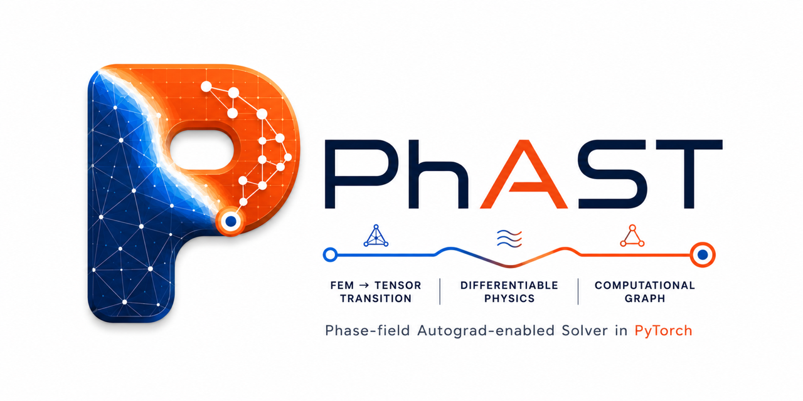
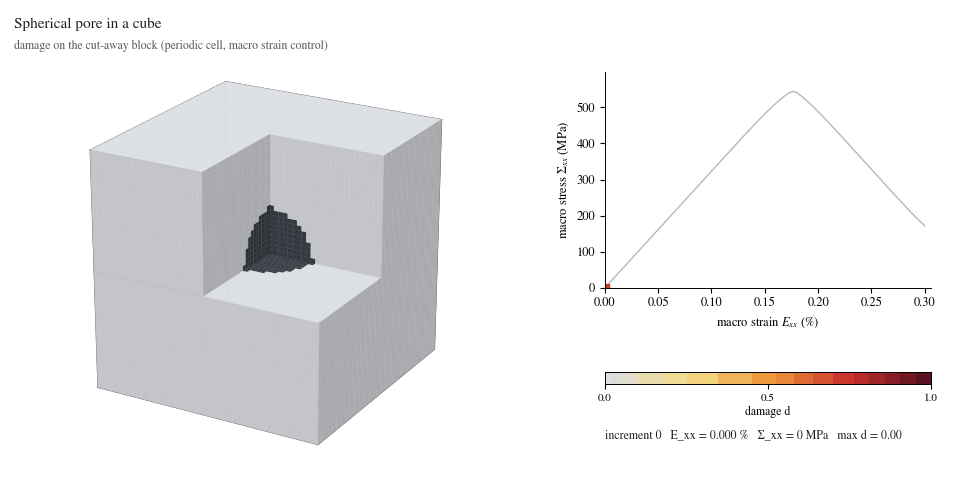
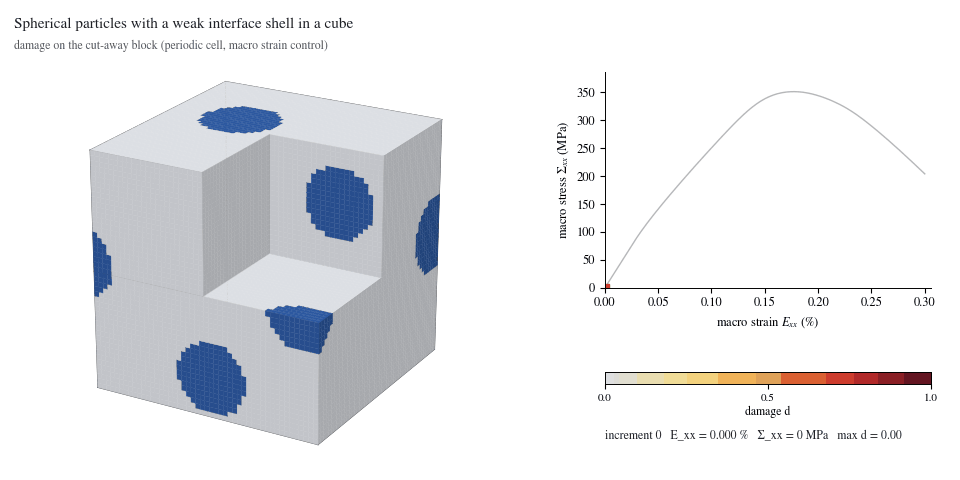
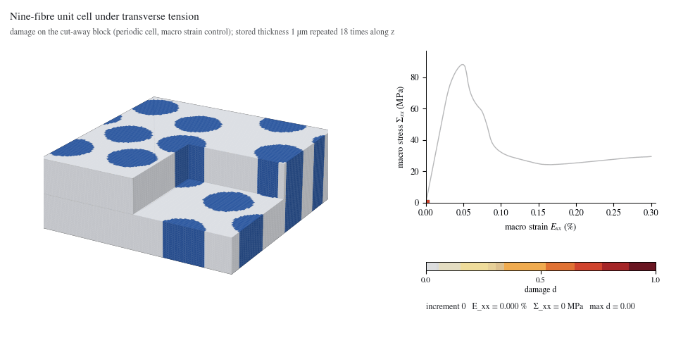
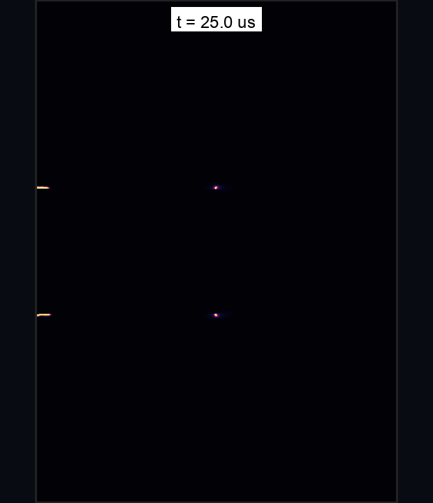
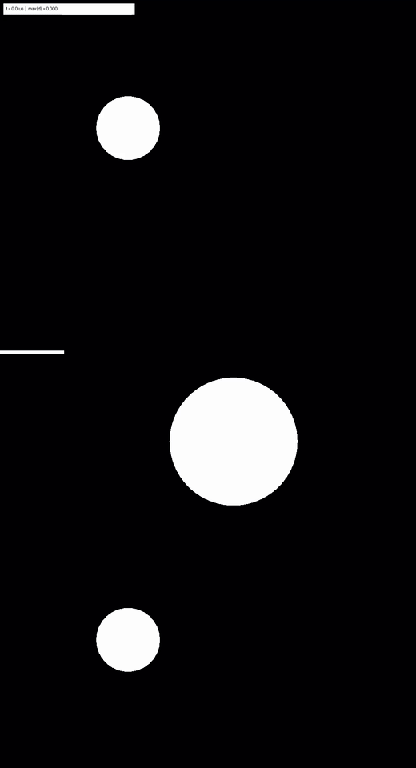
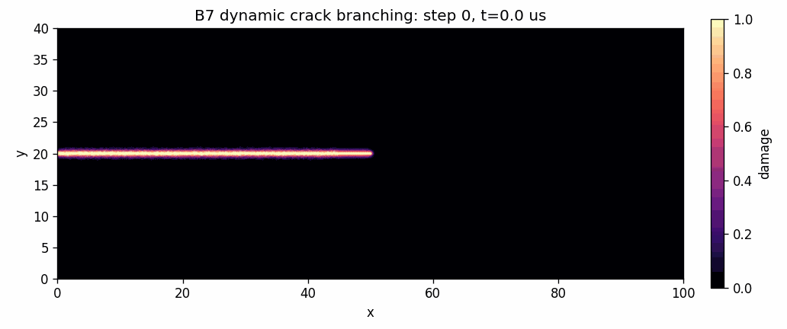
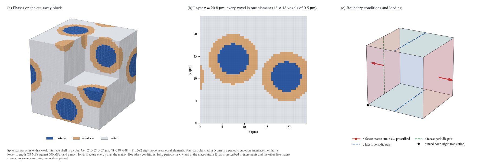

<p align="center">
  
</p>

<h1 align="center">PhAST: A 2D and 3D Phase-Field Fracture Solver</h1>

<p align="center">
  <strong>Phase-field Autograd Solver in Torch</strong><br>
  Two-dimensional phase-field fracture and three-dimensional periodic voxel examples in PyTorch.
</p>

<p align="center">
  <a href="https://cems-lab.github.io/PhAST/">Documentation</a> |
  <a href="docs/getting-started.md">Getting Started</a> |
  <a href="#quickstart">Quickstart</a> |
  <a href="docs/example-gallery.md">Examples</a> |
  <a href="docs/community.md">Community</a> |
  <a href="CITATION.cff">Citation</a> |
  <a href="https://github.com/CEMS-Lab/PhAST/releases">Releases</a>
</p>

<p align="center">
  <a href="https://doi.org/10.1016/j.cma.2026.119547"></a>
  
  
  
  
  
  
</p>

---

## What is PhAST?

PhAST is a research finite-element solver implemented in PyTorch for
phase-field fracture in two dimensions and, as a beta capability, in three
dimensions on periodic voxel cells. Its principal dynamic pathway evaluates
finite-element operators through tensor gather-compute-scatter operations
without retaining a global stiffness matrix. Selected operations remain
compatible with PyTorch autograd, subject to the documented limitations of
nonsmooth history updates, bounds, active sets, and optional sparse backends.

*(New to phase-field modeling? Read our [Phase-Field Primer](docs/tutorial/01_phase_field_primer.md) to learn the basics).*

Models can be authored programmatically through the `phast.Problem` Python API
or executed from YAML configurations. YAML is the reference format for shared
examples because it records geometry, materials, boundary conditions, solver
controls, and requested outputs in one reviewable file.

### 3D Examples

These periodic voxel examples extend the 2D solver. The 3D implementation is
beta and quasi-static; see [its scope](#2d-and-3d) before selecting a problem.

| Pore in a cube | Particles with weak interfaces | Nine-fibre unit cell |
| --- | --- | --- |
| [](examples/three_dimensional/pore_in_cube/README.md) | [](examples/three_dimensional/particles_in_cube/README.md) | [](examples/three_dimensional/fibre_unit_cell/README.md) |

Each folder includes its Python setup, geometry and boundary-condition
figure, recorded response curve and damage images. The fibre visual repeats
the two-voxel-thick solution along the fibre direction for display.

## Core Strengths

- **Matrix-Free Operators:** Explicit fracture mechanics and damage updates use operations on PyTorch tensors without persistent global stiffness assembly on the main dynamic path.
- **Differentiable Mechanics:** Supported tensor operations remain compatible
  with PyTorch autograd where documented, enabling carefully interpreted
  sensitivity studies.
- **2D And 3D:** The 2D solvers (triangles and quadrilaterals) cover dynamic and quasi-static fracture. The beta `phast.solid3d` solver runs 3D problems on eight-node hexahedral voxel meshes: pores, particles with weak interfaces and fibre unit cells, with the same result file as the 2D runs ([3D examples](#2d-and-3d)).
- **Phase-Field Fracture Focus:** Dynamic impact, crack branching, and quasi-static fracture workflows share a consistent mechanics/damage formulation and output schema.
- **Documented Examples:** Examples provide `config.yaml`, setup figures, final field plots, response histories, manifests, and compact animations. Numerical fields can be reloaded when the result directory contains a result file (`result.vtkhdf`, written by default by the YAML runner) or a trajectory store.
- **YAML Plus Fluent API:** Use declarative YAML for reproducible runs and `phast.Problem` for programmatic model authoring.
- **Standardised Post-Processing:** `phast.load_result` reads stored manifests, CSV histories, visualisations, and available stored fields from the result file or a trajectory store.
- **HDF5 Results:** The supported single-material 2D YAML routes and the 3D voxel runner write `result.vtkhdf`, containing the mesh, stored fields, histories and model settings. Read it with `phast.load_result` or ParaView. The multi-material route has a different output path. File recovery restores readable data from an interrupted write; it does not restart the simulation. See [Result file](docs/user_guide/result_file.md).

## How The Solver Works

`YAML / phast.Problem` -> `Mesh` -> `Operators` -> `Solver` -> `Result bundle`

For a phase-field fracture run, PhAST constructs or imports a two-dimensional
finite-element mesh (or, for the beta 3D solver, a periodic voxel grid), evaluates the mechanical state, updates the tensile
history field, solves the regularised damage problem, enforces damage bounds
and irreversibility, and writes fields, histories, manifests, and run metadata.
Explicit dynamics and quasi-static fracture use different mechanics updates;
the [solver overview](docs/user_guide/overview.md) and
[formulation guide](docs/user_guide/physics.md) describe both pathways.

## For New Users

If you are new to PhAST, follow this sequence:

1. Read the [phase-field primer](docs/tutorial/01_phase_field_primer.md) if the
   formulation is new to you.
2. Follow the [standard simulation tutorial](docs/tutorial/07_standard_simulation_workflow.md)
   for source installation and the common editable YAML layout.
3. Explain and check a fracture input before allocating a full simulation.
4. Run the small linear-elastic example to check solver execution and result
   loading on the current machine.
5. Consult the [capability matrix](docs/user_guide/capability_matrix.md) before
   selecting a model for research use.

## Quickstart

For a downloaded ZIP, extract it, enter the extracted `PhAST-0.18.0`
directory and install that copy:

```bash
python3 -m venv .venv
source .venv/bin/activate
python -m pip install --upgrade pip
python -m pip install -e .
python -m phast doctor
```

On Windows, use `py -3 -m venv .venv` and
`.\.venv\Scripts\Activate.ps1` for the first two commands.
The Git commands below are for obtaining the development repository instead.

Install Python 3.10 or newer and Git first. These commands install the source
checkout you clone; they do not assert that it is the latest release.

On macOS or Linux:

```bash
git clone https://github.com/CEMS-Lab/PhAST.git
cd PhAST
python3 -m venv .venv
source .venv/bin/activate
python -m pip install --upgrade pip
python -m pip install -e .

python -m phast doctor
```

On Windows PowerShell:

```powershell
git clone https://github.com/CEMS-Lab/PhAST.git
cd PhAST
py -3 -m venv .venv
.\.venv\Scripts\python.exe -m pip install --upgrade pip
.\.venv\Scripts\python.exe -m pip install -e .
.\.venv\Scripts\Activate.ps1
python -m phast doctor
```

Ensure `python3` or `py -3` selects Python 3.10 or newer. If activation
is blocked on Windows, use `.\.venv\Scripts\python.exe` instead of
`python` in subsequent commands; do not change system policy.

Editable installation already installs runtime dependencies. To install
them separately in the same environment, use:

```bash
python -m pip install -r requirements.txt
python -m pip install -e .
```

The main student route is the small single-material quasi-static SENT,
small single-material dynamic SENT, and full layered DCB example in the
[standard tutorial](docs/tutorial/07_standard_simulation_workflow.md).
The new adapters and schema-2 explanation command require combined checks
before those sequences are labelled verified. Existing compatibility
examples below provide a separate established first-check route.

Validate a public fracture configuration without launching a full solve:

```bash
python -m phast run examples/dynamic/B2_kalthoff_winkler/config.yaml --validate-only
```

`--validate-only` checks the schema and semantic consistency of the input. It
does not run the solver or establish mesh convergence, benchmark reproduction,
or physical validity.

Expected validation output:

```text
OK: examples/dynamic/B2_kalthoff_winkler/config.yaml passes schema validation.
```

Inspect the parsed problem definition before execution:

```bash
python -m phast explain-config examples/quasistatic/notched_holed_plate/config.yaml
```

Run a compact end-to-end mechanics example and inspect its output:

```bash
python -m phast run examples/solid_mechanics/linear_plate/config.yaml \
  --output_dir runs/linear_plate
```

```python
import phast

result = phast.load_result("runs/linear_plate")
print(result.metadata())
print(result.history_names())
print(result.visuals())
```

PhAST itself does not require a separate CMake build. Optional PETSc/MUMPS,
AmgX, cuDSS, and other platform-specific backends are not required for this
first workflow.

## Reproducible Workflows

The [standard simulation workflow](docs/tutorial/07_standard_simulation_workflow.md)
uses one schema-2 layout for editable geometry, mesh, materials, and loading.
It includes retained DCB PNG/GIF evidence and complete coarse comparison
inputs using the same CLI, not new solver drivers. The DCB result is
qualitative layered-material interaction, not calibrated inclusion bypass.
Its multi-material route is limited to CPU float64, structured-T3,
quasi-static Amor AT2, and prescribed-displacement conditions.

<table>
  <tr>
    <td align="center" width="33%">
      
    </td>
    <td align="center" width="33%">
      
    </td>
    <td align="center" width="33%">
      
    </td>
  </tr>
  <tr>
    <td align="center"><strong>Kalthoff-Winkler Impact</strong></td>
    <td align="center"><strong>Quasi-Static Fracture</strong></td>
    <td align="center"><strong>Dynamic Crack Branching</strong></td>
  </tr>
</table>

| Simulation Category | Execution Command | Expected Artifacts |
|---|---|---|
| **Dynamic Crack Branching** | `python -m phast run examples/dynamic/B7_dynamic_crack_branching_comsol/config.yaml` | Damage fields, kinetic-energy histories, metadata, and visual summaries. |
| **Dynamic Fracture** | `python -m phast run examples/dynamic/B2_kalthoff_winkler/config.yaml` | Crack-propagation states, CSV histories, damage plots, and optional trajectory outputs. |
| **Quasi-Static Fracture** | `python -m phast run examples/quasistatic/notched_holed_plate/config.yaml` | Load-displacement response curves, final phase-field damage, and comparison artifacts. |
| **Solid Mechanics Beta** | `python -m phast run examples/solid_mechanics/linear_plate/config.yaml` | Mesh-level FEA fields, nodal displacements, visual manifests, and structured metadata. |

Browse the full [example gallery](docs/example-gallery.md) for the complete list of runnable examples. Beta examples are provided for inspection, but they have not yet been validated as extensively as the included fracture benchmarks.

## 2D And 3D

The 2D examples use AT1 or AT2 fracture models. The beta 3D solver uses PF-CZM
on periodic voxel cells. Each 3D example includes a mesh and boundary-condition
figure, a launcher written with `phast.solid3d`, a damage animation and a README describing its settings and results.

<p align="center">
  
</p>

A 3D problem is a few lines of Python. This is the whole pore example:

```python
from phast import solid3d

cell = solid3d.PeriodicCell(size_um=(24, 24, 24), voxel_um=0.5)
cell.add_sphere_pore(diameter_fraction=0.4)                                   # pore diameter 0.4 L at the cell centre
matrix = solid3d.Material(E=345e3, nu=0.2, strength=600.0, Gc=25e-3)         # MPa, -, MPa, N/mm
problem = solid3d.Problem(cell, materials={"matrix": matrix},
                          load=solid3d.MacroStrain("xx", to=3e-3, increments=150),
                          damage=solid3d.PFCZM(length_scale_um=1.5))
summary = problem.run("runs/pore_in_cube", device="cpu")                      # writes runs/pore_in_cube/result.vtkhdf
```

```bash
# Run four increments, then run the full problem in a separate output directory.
python examples/three_dimensional/pore_in_cube/run.py --output-dir runs/pore_in_cube_quick --max-increments 4
python examples/three_dimensional/pore_in_cube/run.py --output-dir runs/pore_in_cube
```

### One result file for 2D and 3D

```python
import phast

result = phast.load_result("runs/pore_in_cube/result.vtkhdf")      # the same call reads a 2D run
last = result.steps()[-1]
damage = result.field("damage", last)                              # nodal damage on the voxel grid
history = result.history("history")                                # one row per increment: macro strain and stress, energies, damage measures
```

```bash
python -m phast result validate runs/pore_in_cube/result.vtkhdf   # check the layout; open the file in ParaView directly
```

**Scope of the 3D solver (beta).** Periodic unit cells on regular voxel grids with eight-node hexahedral elements, a prescribed macro strain component with the other
macro stresses free, PF-CZM damage with a spectral energy split, a different material and fracture energy in every voxel, float64 on CPU or CUDA. Not yet available in 3D:
general (non-voxel) meshes, notched specimens with applied face loads, contact and dynamics. The examples are not validated against experiments; the interface and matrix
strengths are assumed numerical values. See the [3D examples](examples/three_dimensional/README.md) and the [capability matrix](docs/user_guide/capability_matrix.md).

## Reproducing The CMAME Article

The [article reproduction guide](reproduction/cmame_2026/README.md) provides
the glass and alumina scalar inversion drivers and stored recovery histories.
The [inverse example](examples/inverse/README.md) uses the selected
cross-mesh setup: original mesh `h = 0.125 mm` and inverse mesh
`h = 0.1875 mm`.

The ZIP also contains the 2D worked examples and three additional 3D examples.
It is not a complete archive of every calculation or figure in the article;
the [coverage table](docs/paper-reproduction.md) identifies what is included.

## Documentation & API

| Objective | Interface | Documentation Link |
|---|---|---|
| Learn one editable input layout | Schema-2 student workflow | [Standard Simulation Workflow](docs/tutorial/07_standard_simulation_workflow.md) |
| Author a forward model | Fluent `phast.Problem` API | [Python API](docs/user_guide/python_api.md) |
| Execute public benchmarks | Declarative `config.yaml` | [YAML Workflow](docs/user_guide/yaml_workflow.md) |
| Post-process simulation data | `phast.load_result(path)` | [Public API Reference](docs/user_guide/public_api_reference.md) |
| Review supported physics | Capability matrix | [Capability Matrix](docs/user_guide/capability_matrix.md) |
| Learn step-by-step setup | Tutorial notebook | [Problem Setup Walkthrough](docs/tutorial/problem_setup_walkthrough.ipynb) |
| Learn elementwise `E(x)` and `Gc(x)` fields | Script-contract teaching example | [Heterogeneous Material Fields](docs/tutorial/05_heterogeneous_material_fields.md) |
| Diagnose failed runs | Troubleshooting guide | [Troubleshooting](docs/troubleshooting.md) |

### Programmatic Authoring

```python
import phast

problem = (
    phast.Problem("linear plate")
    .geometry("structured_grid", nx=40, ny=12, length=1.0, height=0.2)
    .region("body", kind="domain")
    .material("steel", model="solid_mechanics", region="body", E=2.1e11, nu=0.3)
    .analysis_step("load", kind="solid_mechanics", controls={"tip_force_y": -1.0e3})
    .solver("solid_mechanics", example="solid_mechanics.linear_plate")
    .outputs(fields=["displacement", "von_mises"], histories=["response"], plots=True)
)

spec = problem.to_spec()
```

### Result Inspection

```python
import phast

result = phast.load_result("runs/linear_plate")
print(result.metadata())
print(result.visuals())
print(result.history_names())
```

On supported routes, `result.vtkhdf` stores field arrays, history tables,
materials, boundary conditions and provenance.
`python -m phast result validate|recover|finalize` checks, recovers or finalises
the file. Resuming a simulation is a separate solver operation and requires
a compatible checkpoint. The layout is specified in
[Result file layout](docs/user_guide/result_file_layout.md).

## Repository Map

| Path | Purpose |
|---|---|
| `src/phast/api/` | `Problem` (fluent model builder) and `Result` (reader for result files). |
| `src/phast/core/` | Meshes, element kernels (T3, Q4, P2, TET4 geometry, H8), FEM operators, device handling. |
| `src/phast/solvers/` | Mechanics, damage, staggered coupling, sparse and multigrid solves, time integrators. |
| `src/phast/physics/` | Material laws, boundary and initial conditions, plasticity, cohesive elements, PF-CZM relations. |
| `src/phast/solid3d/` | Beta 3D voxel solver: periodic cells, per-voxel materials, `result.vtkhdf` output. |
| `src/phast/io/` | YAML configuration and schema, result files, trajectory outputs, provenance. |
| `src/phast/cli/`, `src/phast/viz/`, `src/phast/workflow/` | Command-line helpers, figure style and post-processing, fluent problem specification and example runners. |
| `examples/` | Runnable examples by family (`dynamic`, `quasistatic`, `solid_mechanics`, `plasticity_interface`, `three_dimensional`, ...), each with a README and lightweight reference outputs; `_common/` holds shared figure helpers. |
| `configs/` | Runnable benchmark decks, the YAML reference template and schema, and explicitly labelled reproducibility contracts. |
| `docs/` | Sphinx documentation, capability matrices, tutorials and user guides; `docs/maintainer/` holds the style guides. |
| `tools/` | Installation checks and plotting utilities. |
| `reproduction/cmame_2026/` | [Scalar inversion recipes and recorded histories](reproduction/cmame_2026/README.md) for the CMAME article. |
| `tests/` | Unit and integration tests. |
| `assets/` | Lightweight visual assets for repository documentation. |
| `.github/` | Issue templates, Pull Request guidelines, and CI/CD Action workflows. |

Older flat import paths (`phast.mesh`, `phast.damage_solver`, ...) still work; the table is in [`src/phast/_compat.py`](src/phast/_compat.py).

## Contributing

Contributions are welcome for solver kernels, example cases, validation scripts,
post-processing utilities, documentation, and performance improvements. Start
with [CONTRIBUTING.md](CONTRIBUTING.md), then use the [capability matrix](docs/user_guide/capability_matrix.md)
and [example contract](docs/user_guide/example_contract.md) to keep public
claims, examples, and artifacts consistent.

New YAML examples and their READMEs/tutorials must follow
[docs/maintainer/CONFIGURATION_STYLE.md](docs/maintainer/CONFIGURATION_STYLE.md) alongside
[docs/maintainer/DOCUMENTATION_STYLE.md](docs/maintainer/DOCUMENTATION_STYLE.md).

Students, researchers, scientific-software developers, and users evaluating
PhAST are invited to review the code and documentation, propose reproducible
examples, and report unclear instructions. If you become stuck at any point,
[open an issue](https://github.com/CEMS-Lab/PhAST/issues/new/choose). A question
about installation or usage is a valid issue and helps improve the documentation
for subsequent users.

## Build The Docs

```bash
pip install -r docs/requirements.txt
sphinx-build -b html docs docs/_build/html
open docs/_build/html/index.html
```

Hosted documentation is published at <https://cems-lab.github.io/PhAST/>.

Release history and version-specific notes are maintained in
[GitHub Releases](https://github.com/CEMS-Lab/PhAST/releases), which is the
project changelog referenced by the package metadata.

## Citation

If PhAST contributes to your research, please cite the journal article
([doi:10.1016/j.cma.2026.119547](https://doi.org/10.1016/j.cma.2026.119547)) and the software repository metadata in
[`CITATION.cff`](CITATION.cff). The preprint is [arXiv:2606.23458](https://arxiv.org/abs/2606.23458)
(its title differs from the journal title).

The Sphinx documentation includes a short [how-to-cite page](docs/citing.md)
with a repository BibTeX entry and reproducibility notes.

```bibtex
@article{ani2026phast,
  title={PhAST: A differentiable, matrix-free finite-element solver for dynamic phase-field fracture: Formulation, benchmarks, and inverse analysis},
  author={Ani, Allamaprabhu and Molinari, Jean-François and Subhash, Ghatu and Ponnusami, Sathiskumar A.},
  journal={Computer Methods in Applied Mechanics and Engineering},
  year={2027},
  volume={464},
  pages={119547},
  doi={10.1016/j.cma.2026.119547},
  eprint={2606.23458},
  archivePrefix={arXiv},
  primaryClass={cs.CE}
}
```

Official code for the article is hosted in this repository:
<https://github.com/CEMS-Lab/PhAST>.

<!-- PhAST | Allamaprabhu Ani | https://allamaprabhuani.github.io/ -->

## Acknowledgments

The governing equations and numerical methods follow the computational
mechanics literature cited in the article and documentation.
The authors are responsible for the software and its documented limitations.

PhAST is organised to support reproducible scientific computing. Machine-readable manifests, structured result metadata, command-line and Python interfaces, and repository guidance allow researchers to inspect, reproduce, and extend simulations without relying on undocumented local settings. Scientific claims remain limited to the formulations, tests, and validation cases described in the documentation.
