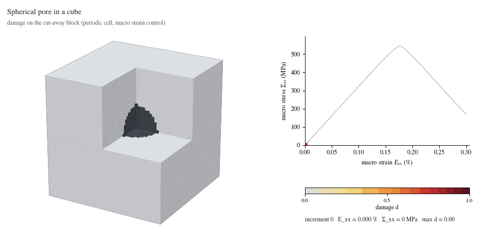
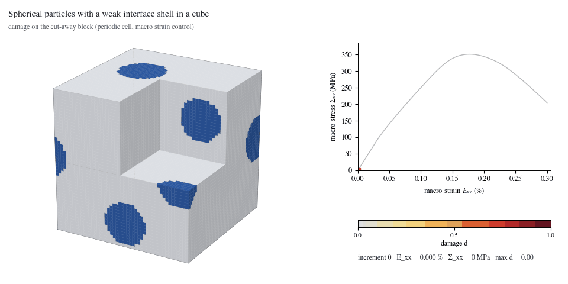
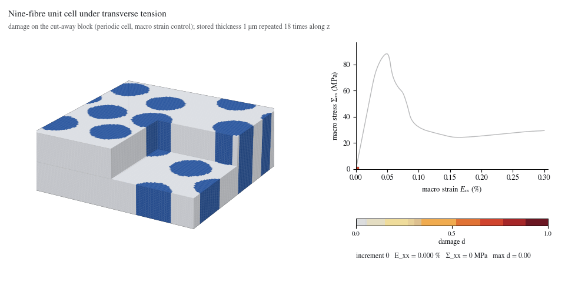

# Three-dimensional fracture examples

PhAST solves 3D phase-field fracture on eight-node hexahedral (voxel) meshes, next to its 2D solvers. These three examples show the 3D path end to end: the mesh and
boundary conditions, the problem definition and launcher, and the damage evolving in a cut-away block.

<table>
  <tr>
    <td align="center"><a href="pore_in_cube/"></a></td>
    <td align="center"><a href="particles_in_cube/"></a></td>
    <td align="center"><a href="fibre_unit_cell/"></a></td>
  </tr>
  <tr>
    <td align="center"><a href="pore_in_cube/"><strong>Pore in a cube</strong></a><br>crack nucleation at a void<br>110,592 elements</td>
    <td align="center"><a href="particles_in_cube/"><strong>Particles with a weak interface</strong></a><br>debonding that links particles<br>110,592 elements</td>
    <td align="center"><a href="fibre_unit_cell/"><strong>Nine-fibre unit cell</strong></a><br>interface debonding across fibres<br>21,218 elements</td>
  </tr>
</table>

| Example | Physics | Elements | Peak stress | Run on the figures |
|---|---|---|---|---|
| [`pore_in_cube`](pore_in_cube/) | spherical pore in an isotropic ceramic matrix, tension along x | 110,592 | 543 MPa at 0.176 % | 3.8 h, 32 CPU cores |
| [`particles_in_cube`](particles_in_cube/) | four particles with a weak interface shell, tension along x | 110,592 | 351 MPa at 0.178 % | 14.7 h, 32 CPU cores |
| [`fibre_unit_cell`](fibre_unit_cell/) | nine fibres with an interface band, transverse tension | 21,218 | 88 MPa at 0.048 % | 2.6 h, one A100 GPU |

Each folder holds a `README.md`, the launcher `run.py` (the problem, written with `phast.solid3d`) and an `assets/` folder with the mesh and boundary-condition figure
(`initial_conditions.png`), a damage animation (`damage_evolution.gif` and `.mp4`) and the manifests. A setup check of any example takes under a minute:

```bash
python examples/three_dimensional/pore_in_cube/run.py --output-dir runs/pore_in_cube_quick --max-increments 4
```

## Scope

These examples use the periodic voxel solver `phast.solid3d`:

- eight-node hexahedral elements on a regular voxel grid, float64 on CPU or CUDA;
- a unit cell that is periodic in x, y and z, loaded by a prescribed macro strain component with the other macro stress components free (zero);
- PF-CZM damage with a spectral energy split, crack closure, box-constrained irreversibility and a staggered solve, with a different material, strength and
  fracture energy for every voxel;
- one `result.vtkhdf` file per run, readable with `phast.load_result` and ParaView.

Not yet available in 3D: general (non-voxel) meshes, notched specimens with applied face loads or displacements, contact, and dynamics. The examples
are labelled beta. They show that the solver runs, localises damage and writes standard results in 3D; they are not validated against experiments, the strengths of the
interface and the matrix are assumed numerical values, and no mesh refinement study was done for them.

## Regenerating the pictures

`examples/_common/render_3d_assets.py` draws the pictures of a folder from a finished run (`result.vtkhdf`, or the older `accepted_fields.h5` with `history.csv`):

```bash
python examples/_common/render_3d_assets.py pore_in_cube --run-dir runs/pore_in_cube --out examples/three_dimensional/pore_in_cube/assets
```

The block is drawn with a cut-away corner so that the planes through the cell centre are visible. Faces are coloured per voxel with the average of the eight nodal
damage values of the element; nothing is smoothed. The fibre cell is two voxels thick and uniform along the fibre axis, so its block repeats the stored layers 18 times
along z; the manifest records this.
