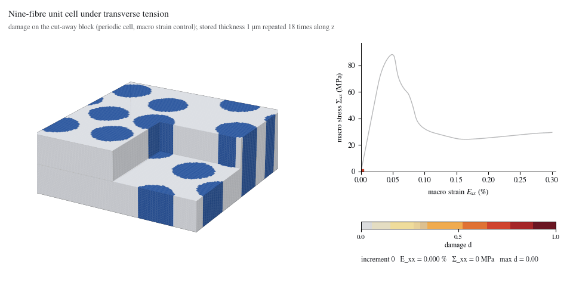
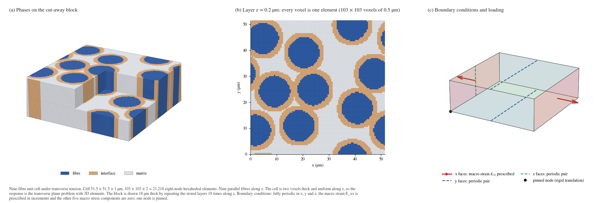
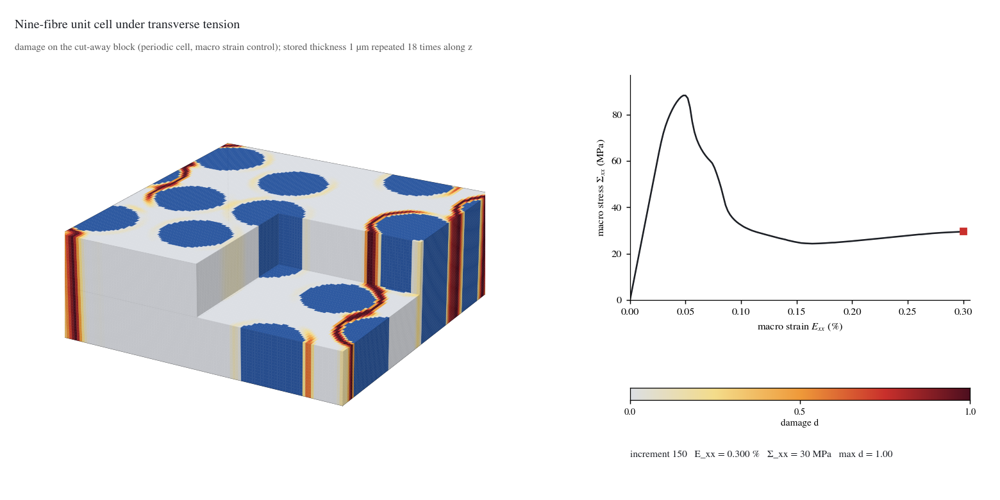

# Nine-fibre unit cell

<p align="center"></p>

A periodic unit cell of nine parallel fibres in a matrix, with a weak interface band around each fibre, pulled across the fibres. Damage debonds the interfaces and links neighbouring fibres. The cell is two voxels thick and uniform along the fibre axis, so the response is the transverse plane problem solved with 3D elements; the block in the pictures repeats the stored layers along z.

Status: beta (periodic voxel solver `phast.solid3d`, see the [family README](../README.md)). Material values are literature-based inputs for a ceramic matrix composite; the strengths of the interface and the matrix are assumed numerical values.

## Problem setup

| Item | Value |
|---|---|
| Cell | 51.5 × 51.5 × 1 µm, periodic in x, y and z |
| Mesh | 103 × 103 × 2 voxels of 0.5 µm = 21,218 hexahedral elements |
| Geometry | nine parallel fibres of 13.7 µm diameter along z, dense random packing (seed 20261002, 2000 Monte Carlo sweeps), fibre volume fraction 0.5; an interface band about 3.7 voxels wide around each fibre |
| Fibre | isotropic, E 270.0 GPa, strength 3136 MPa, G<sub>c</sub> 518 J/m² |
| Interface band | smeared, E 119.7 GPa, strength 63 MPa, G<sub>c</sub> 0.646 J/m² |
| Matrix | isotropic, E 345.0 GPa, strength 600 MPa, G<sub>c</sub> 25 J/m² |
| Fracture model | PF-CZM damage law (linear softening), ℓ = 1.5 µm, spectral split, box-constrained irreversibility, staggered solve, float64 |
| Loading | macro strain E<sub>xx</sub> from 0 to 0.30 % in 150 increments; the other five macro stress components are zero |
| Boundary conditions | fully periodic; one node pinned |



## What the result shows

- The macro stress peaks at **88 MPa at 0.048 % strain** (increment 24) and falls to 30 MPa at 0.30 %.
- Damage starts in the interface bands at the fibre poles on the load axis (the first state with d > 0.2 is at 0.05 % strain, 13° from the load axis) and joins the fibres into a crack path that bends around them; 1.7 % of the volume is damaged at the end.
- All 150 increments converged without cutbacks. The largest relative energy-balance residual is 6.3 %; treat the late post-peak path as a demonstration.
- Cost: 2.6 h of solving on one NVIDIA A100 GPU, 50 stored states.



## Setup code

`run.py` describes the problem with the `phast.solid3d` API. This is all of it:

```python
def build_problem() -> solid3d.Problem:
    image = np.load(Path(__file__).with_name("microstructure.npz"))                          # phase_id (nz, ny, nx) and the interface normal of every voxel
    cell = solid3d.PeriodicCell.from_phase_ids(image["phase_id"], float(image["voxel_um"]), image["tangent"])
    matrix = solid3d.Material(E=345e3, nu=0.2, strength=600.0, Gc=25e-3)                    # MPa, -, MPa, N/mm
    fibre = solid3d.Material(E=270e3, nu=0.2, strength=3136.0, Gc=0.5180310650205762)
    interface = solid3d.Interface(
        E=119683.28713197137, nu=0.2, strength=63.0, Gc=0.0006463399858678095,
        layers=((0.10823084088511756, 20000.0, 0.2), (0.4458845795574412, 270000.0, 0.2), (0.4458845795574412, 345000.0, 0.2)))
    return solid3d.Problem(
        cell, materials={"matrix": matrix, "inclusion": fibre, "interface": interface},
        load=solid3d.MacroStrain("xx", to=3e-3, increments=150),            # E_xx to 0.30 %; the other macro stresses are zero
        damage=solid3d.PFCZM(length_scale_um=1.5),
    )
```

The cell is periodic in x, y and z. One macro-strain component is prescribed and the other five macro stress components are zero. Units: micrometres for the cell,
MPa for stress, N/mm for fracture energy.

## Run it

Check the setup first (about half a minute on a laptop; the first increments are elastic):

```bash
python examples/three_dimensional/fibre_unit_cell/run.py --output-dir runs/fibre_unit_cell_quick --max-increments 4
```

Run the full problem (21,218 elements, 150 increments: 2.6 h on one NVIDIA A100 GPU; add `--device cuda` for a GPU):

```bash
python examples/three_dimensional/fibre_unit_cell/run.py --output-dir runs/fibre_unit_cell
```

The output folder must not exist and must lie outside a cloud-synchronised folder.

## Read the result

A run writes one `result.vtkhdf` file (float64): the voxel grid, the damage, displacement, stress and strain of the stored increments, a history row for every
increment, and the material and boundary-condition description. It is the same result file the 2D runs write.

```python
import phast

result = phast.load_result("runs/fibre_unit_cell/result.vtkhdf")
last = result.steps()[-1]
damage = result.field("damage", last)                 # nodal damage, shape (nz+1, ny+1, nx+1)
history = result.history("history")                   # one row per increment: macro strain and stress, energies, damage measures
print(history[-1]["macro_stress_xx"], history[-1]["max_damage"])
```

```bash
python -m phast result validate runs/fibre_unit_cell/result.vtkhdf    # checks the layout
```

Open the file in ParaView directly. The pictures of this folder are drawn from a result with

```bash
python examples/_common/render_3d_assets.py fibre_unit_cell --run-dir runs/fibre_unit_cell --out examples/three_dimensional/fibre_unit_cell/assets
```

The pictures shown here come from a 150-increment run of the same problem with the earlier field writer; the first four increments of a new run agree with its stored
macro stress to better than 3 × 10<sup>-14</sup> (relative).

## Files

| File | Content |
|---|---|
| `run.py` | the problem and the launcher |
| `microstructure.npz` | the phase and interface normal of every voxel (nine fibres, seed 20261002 packing) |
| `assets/initial_conditions.png` | mesh and boundary conditions |
| `assets/damage_evolution.gif`, `assets/damage_evolution.mp4` | damage on the cut-away block next to the stress-strain curve, one frame per stored state |
| `assets/damage_final.png`, `assets/thumbnail.png`, `assets/stress_strain.png`, `assets/history.csv` | final state, thumbnail, macro curve, history of every increment |
| `assets/visual_manifest.json`, `assets/run_manifest.json` | pictures and provenance (source hash, drawing settings) |

## Limits

- This is a periodic voxel unit cell with eight-node hexahedral elements and prescribed macro strain. It is not a general-geometry 3D specimen, and
  the solver has no 3D notched-specimen or contact workflow yet.
- The strengths of the interface and of the matrix are assumed numerical values. The results are not validated against an experiment.
- The length scale is 1.5 µm on voxels of 0.5 µm (ℓ/h = 3); no mesh refinement was done for this example.
- The pictures show the damage of the stored states; the 0.3 % strain end state is a post-peak state, not a fully separated specimen.
