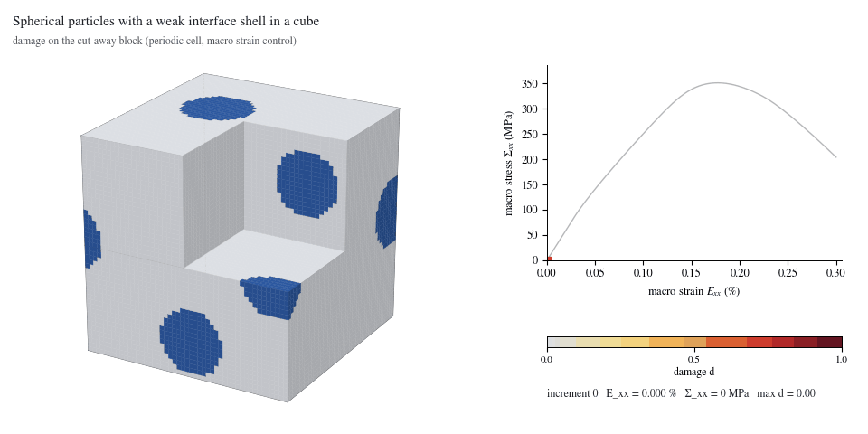
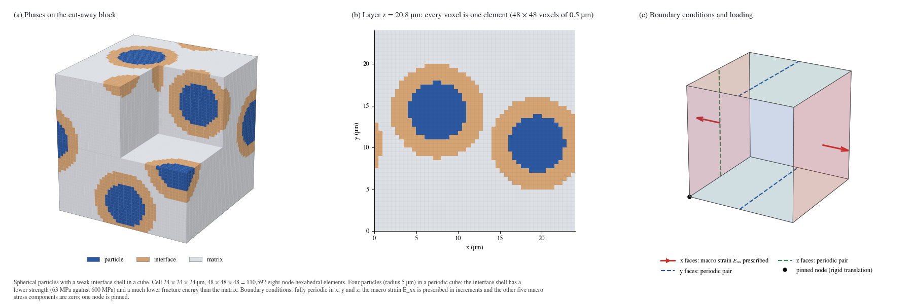
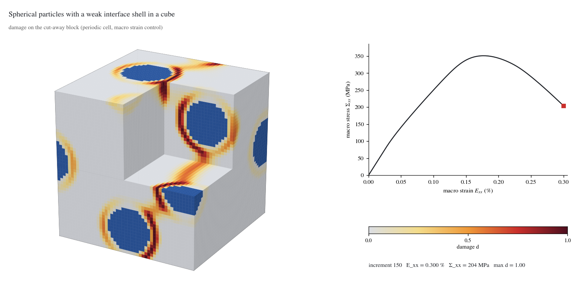

# Particles with a weak interface in a cube

<p align="center"></p>

A periodic cube of ceramic matrix with four spherical particles, each wrapped in a weaker interface shell, pulled in tension along x. Damage runs around the particles and links them: interface debonding that forms a connected 3D crack path.

Status: beta (periodic voxel solver `phast.solid3d`, see the [family README](../README.md)). Material values are literature-based inputs for a ceramic matrix composite; the strengths of the interface and the matrix are assumed numerical values.

## Problem setup

| Item | Value |
|---|---|
| Cell | 24 × 24 × 24 µm, periodic in x, y and z |
| Mesh | 48 × 48 × 48 voxels of 0.5 µm = 110,592 hexahedral elements |
| Geometry | four spheres of radius 5 µm by random sequential addition (seed 20261023, minimum gap 1 µm); an interface shell about 3.7 voxels thick straddles each surface |
| Particle | isotropic, E 270.0 GPa, strength 3136 MPa, G<sub>c</sub> 518 J/m² |
| Interface shell | smeared, E 122.6 GPa, strength 63 MPa, G<sub>c</sub> 0.646 J/m² (calibrated on a single coated cylindrical fibre, applied here to spheres) |
| Matrix | isotropic, E 345.0 GPa, strength 600 MPa, G<sub>c</sub> 25 J/m² |
| Fracture model | PF-CZM damage law (linear softening), ℓ = 1.5 µm, spectral split (isotropic in the shell), box-constrained irreversibility, staggered solve, float64 |
| Loading | macro strain E<sub>xx</sub> from 0 to 0.30 % in 150 increments; the other five macro stress components are zero |
| Boundary conditions | fully periodic; one node pinned |



## What the result shows

- The macro stress peaks at **351 MPa at 0.178 % strain** (increment 89) and falls to 204 MPa at 0.30 %.
- Damage starts in the interface shells at the poles of the particles, on the load axis (the first state with d > 0.2 is at 0.07 % strain, 16° from the load axis), then links neighbouring particles through the matrix; the largest damage reaches 1.0 and 0.52 % of the volume is damaged at the end.
- All 150 increments converged without cutbacks. The largest relative energy-balance residual is 4.7 %, larger than in the pore case; treat the late post-peak path as a demonstration.
- Cost: 14.7 h of solving on 32 CPU cores (cluster node), 31 stored states.



## Setup code

`run.py` describes the problem with the `phast.solid3d` API. This is all of it:

```python
def build_problem() -> solid3d.Problem:
    cell = solid3d.PeriodicCell(size_um=(24, 24, 24), voxel_um=0.5)
    cell.add_particles(n=4, radius_um=5.0, interface_um=1.9235993121898142, gap_um=1.0, seed=20261023)
    matrix = solid3d.Material(E=345e3, nu=0.2, strength=600.0, Gc=25e-3)                    # MPa, -, MPa, N/mm
    particle = solid3d.Material(E=270e3, nu=0.2, strength=3136.0, Gc=0.5180310650205762)
    interface = solid3d.Interface(                                                            # laminate of (fraction, E, nu) layers across the shell
        E=122601.74043706217, nu=0.2, strength=63.0, Gc=0.00064633998586781,
        layers=((0.10397175686880507, 20000.0, 0.2), (0.44801412156559745, 270000.0, 0.2), (0.44801412156559745, 345000.0, 0.2)))
    return solid3d.Problem(
        cell, materials={"matrix": matrix, "inclusion": particle, "interface": interface},
        load=solid3d.MacroStrain("xx", to=3e-3, increments=150),            # E_xx to 0.30 %; the other macro stresses are zero
        damage=solid3d.PFCZM(length_scale_um=1.5),
    )
```

The cell is periodic in x, y and z. One macro-strain component is prescribed and the other five macro stress components are zero. Units: micrometres for the cell,
MPa for stress, N/mm for fracture energy.

## Run it

Check the setup first (about half a minute on a laptop; the first increments are elastic):

```bash
python examples/three_dimensional/particles_in_cube/run.py --output-dir runs/particles_in_cube_quick --max-increments 4
```

Run the full problem (110,592 elements, 150 increments: 14.7 h of solving on 32 CPU cores):

```bash
python examples/three_dimensional/particles_in_cube/run.py --output-dir runs/particles_in_cube
```

The output folder must not exist and must lie outside a cloud-synchronised folder.

## Read the result

A run writes one `result.vtkhdf` file (float64): the voxel grid, the damage, displacement, stress and strain of the stored increments, a history row for every
increment, and the material and boundary-condition description. It is the same result file the 2D runs write.

```python
import phast

result = phast.load_result("runs/particles_in_cube/result.vtkhdf")
last = result.steps()[-1]
damage = result.field("damage", last)                 # nodal damage, shape (nz+1, ny+1, nx+1)
history = result.history("history")                   # one row per increment: macro strain and stress, energies, damage measures
print(history[-1]["macro_stress_xx"], history[-1]["max_damage"])
```

```bash
python -m phast result validate runs/particles_in_cube/result.vtkhdf    # checks the layout
```

Open the file in ParaView directly. The pictures of this folder are drawn from a result with

```bash
python examples/_common/render_3d_assets.py particles_in_cube --run-dir runs/particles_in_cube --out examples/three_dimensional/particles_in_cube/assets
```

The pictures shown here come from a 150-increment run of the same problem with the earlier field writer; the first four increments of a new run agree with its stored
macro stress to better than 3 × 10<sup>-14</sup> (relative).

## Files

| File | Content |
|---|---|
| `run.py` | the problem and the launcher |
| `assets/initial_conditions.png` | mesh and boundary conditions |
| `assets/damage_evolution.gif`, `assets/damage_evolution.mp4` | damage on the cut-away block next to the stress-strain curve, one frame per stored state |
| `assets/damage_final.png`, `assets/thumbnail.png`, `assets/stress_strain.png`, `assets/history.csv` | final state, thumbnail, macro curve, history of every increment |
| `assets/visual_manifest.json`, `assets/run_manifest.json` | pictures and provenance (source hash, drawing settings) |

## Limits

- This is a periodic voxel unit cell with eight-node hexahedral elements and prescribed macro strain. It is not a general-geometry 3D specimen, and
  the solver has no 3D notched-specimen or contact workflow yet.
- The strengths of the interface and of the matrix are assumed numerical values. The results are not validated against an experiment.
- The length scale is 1.5 µm on voxels of 0.5 µm (ℓ/h = 3); no mesh refinement was done for this example.
- The pictures show the damage of the stored states; the 0.3 % strain end state is a post-peak state, not a fully separated specimen.
