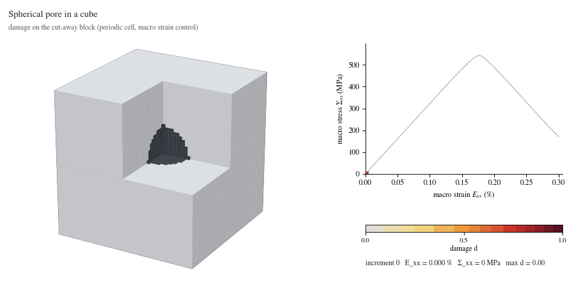
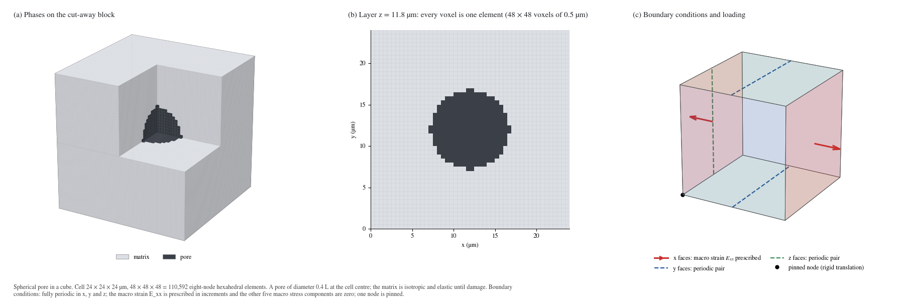
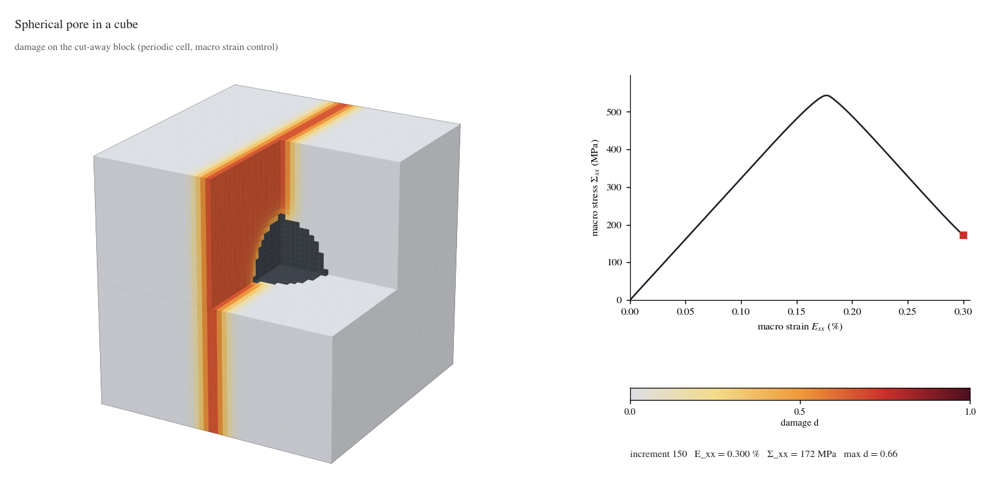

# Spherical pore in a cube

<p align="center"></p>

A periodic cube of ceramic matrix with a spherical pore at its centre, pulled in tension along x. Damage starts at the pore equator and grows into a band across the cell: a 3D crack-nucleation problem on 110,592 eight-node hexahedral elements.

Status: beta (periodic voxel solver `phast.solid3d`, see the [family README](../README.md)). Material values are literature-based inputs for a ceramic matrix composite; the strengths of the interface and the matrix are assumed numerical values.

## Problem setup

| Item | Value |
|---|---|
| Cell | 24 × 24 × 24 µm, periodic in x, y and z |
| Mesh | 48 × 48 × 48 voxels of 0.5 µm = 110,592 hexahedral elements, 117,649 nodes |
| Geometry | one sphere of diameter 0.4 L = 9.6 µm at the cell centre |
| Matrix | isotropic, E 345.0 GPa, ν 0.2, strength 600 MPa, G<sub>c</sub> 25 J/m² |
| Pore | void phase with a stiffness of 10<sup>-6</sup> of the matrix (E = 0.345 MPa) |
| Fracture model | PF-CZM damage law (linear softening), ℓ = 1.5 µm, spectral energy split, crack-closure treatment, box-constrained irreversibility, staggered solve, float64 |
| Loading | macro strain E<sub>xx</sub> from 0 to 0.30 % in 150 increments of 0.002 %; the other five macro stress components are zero |
| Boundary conditions | fully periodic; one node pinned to remove the rigid translation |



## What the result shows

- The macro stress rises linearly to a peak of **543 MPa at 0.176 % strain** (increment 88), then falls to 172 MPa at 0.30 % as the damage band widens.
- Damage localises at the pore equator, the part of the pore surface normal to the load (the first state with d > 0.2 is at 0.21 % strain, about 1 µm outside the pore surface), and grows into a band on the plane through the pore centre that is normal to the load. At the last stored state the largest damage is 0.71: a developed damage band, not a fully separated cell.
- All 150 increments converged without cutbacks. The largest relative energy-balance residual is 0.48 %.
- Cost: 3.8 h of solving on 32 CPU cores (cluster node), 51 stored states.



## Setup code

`run.py` describes the problem with the `phast.solid3d` API. This is all of it:

```python
def build_problem() -> solid3d.Problem:
    cell = solid3d.PeriodicCell(size_um=(24, 24, 24), voxel_um=0.5)
    cell.add_sphere_pore(diameter_fraction=0.4)                                              # pore diameter 0.4 L at the cell centre
    matrix = solid3d.Material(E=345e3, nu=0.2, strength=600.0, Gc=25e-3)                    # MPa, -, MPa, N/mm
    return solid3d.Problem(
        cell, materials={"matrix": matrix},
        load=solid3d.MacroStrain("xx", to=3e-3, increments=150),            # E_xx to 0.30 %; the other macro stresses are zero
        damage=solid3d.PFCZM(length_scale_um=1.5),
    )
```

The cell is periodic in x, y and z. One macro-strain component is prescribed and the other five macro stress components are zero. Units: micrometres for the cell,
MPa for stress, N/mm for fracture energy.

## Run it

Check the setup first (about half a minute on a laptop; the first increments are elastic):

```bash
python examples/three_dimensional/pore_in_cube/run.py --output-dir runs/pore_in_cube_quick --max-increments 4
```

Run the full problem (110,592 elements, 150 increments: 3.8 h of solving on 32 CPU cores):

```bash
python examples/three_dimensional/pore_in_cube/run.py --output-dir runs/pore_in_cube
```

The output folder must not exist and must lie outside a cloud-synchronised folder.

## Read the result

A run writes one `result.vtkhdf` file (float64): the voxel grid, the damage, displacement, stress and strain of the stored increments, a history row for every
increment, and the material and boundary-condition description. It is the same result file the 2D runs write.

```python
import phast

result = phast.load_result("runs/pore_in_cube/result.vtkhdf")
last = result.steps()[-1]
damage = result.field("damage", last)                 # nodal damage, shape (nz+1, ny+1, nx+1)
history = result.history("history")                   # one row per increment: macro strain and stress, energies, damage measures
print(history[-1]["macro_stress_xx"], history[-1]["max_damage"])
```

```bash
python -m phast result validate runs/pore_in_cube/result.vtkhdf    # checks the layout
```

Open the file in ParaView directly. The pictures of this folder are drawn from a result with

```bash
python examples/_common/render_3d_assets.py pore_in_cube --run-dir runs/pore_in_cube --out examples/three_dimensional/pore_in_cube/assets
```

The pictures shown here come from a 150-increment run of the same problem with the earlier field writer; the first four increments of a new run agree with its stored
macro stress to better than 3 × 10<sup>-14</sup> (relative).

## Files

| File | Content |
|---|---|
| `run.py` | the problem and the launcher |
| `assets/initial_conditions.png` | mesh and boundary conditions |
| `assets/damage_evolution.gif`, `assets/damage_evolution.mp4` | damage on the cut-away block next to the stress-strain curve, one frame per stored state |
| `assets/damage_final.png`, `assets/thumbnail.png`, `assets/stress_strain.png`, `assets/history.csv` | final state, thumbnail, macro curve, history of every increment |
| `assets/visual_manifest.json`, `assets/run_manifest.json` | pictures and provenance (source hash, drawing settings) |

## Limits

- This is a periodic voxel unit cell with eight-node hexahedral elements and prescribed macro strain. It is not a general-geometry 3D specimen, and
  the solver has no 3D notched-specimen or contact workflow yet.
- The strengths of the interface and of the matrix are assumed numerical values. The results are not validated against an experiment.
- The length scale is 1.5 µm on voxels of 0.5 µm (ℓ/h = 3); no mesh refinement was done for this example.
- The pictures show the damage of the stored states; the 0.3 % strain end state is a post-peak state, not a fully separated specimen.
